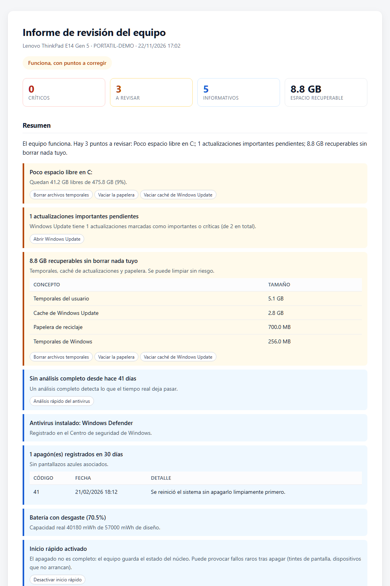

# HERMES-RESCATE

**Auditoría y reparación de equipos Windows desde un USB, sin instalar nada.**

Proyecto de [**Neuraladvance.net**](https://neuraladvance.net) · Licencia MIT ·
[aviso legal y limitación de responsabilidad](DISCLAIMER.md)

Un programa de consola en español que se lleva en el bolsillo: se conecta el USB,
se abre, y en medio minuto tienes el estado real del equipo y un informe en HTML
para entregar al cliente. Funciona **sin internet y sin IA**; el chat con un modelo
es opcional.



*Informe de ejemplo generado con datos inventados: equipo ficticio y direcciones del
rango reservado para documentación (RFC 5737).*

```
  HERMES-RESCATE 1.0  ·  auditoría y reparación de equipos Windows
  Equipo: PORTATIL-01   Usuario: soporte   Admin: sí
  Red: conectado a «Oficina» con internet
  1. Revisar el equipo y generar informe
  2. Reparar lo recomendado
  3. Conectar al WiFi del técnico (hotspot)
  4. Instalar actualizaciones de Windows
  5. Instalar programas
  6. Catálogo de reparaciones
  7. Hablar con la IA
  8. Abrir la carpeta de informes
```

## Qué hace

| Opción | Detalle |
|---|---|
| **1. Revisar** | 39 bloques en ~30 s: hardware, discos (SMART y desgaste), batería real (mWh de diseño vs reales), licencia, Defender, cortafuegos, BitLocker, TPM, Arranque seguro, actualizaciones pendientes, errores del registro, cuelgues y pantallazos, dispositivos con error, servicios caídos, espacio recuperable, red y DNS, WinRE y puntos de restauración. Genera **informe HTML imprimible**, Markdown y JSON con los datos crudos. |
| **2. Reparar** | Aplica solo lo que el diagnóstico justifica. Separa lo seguro de lo que cambia configuración (eso se pregunta una a una) y **verifica** el resultado después. |
| **3. WiFi del técnico** | Crea el perfil WLAN y conecta el equipo al hotspot configurado, para poder descargar actualizaciones. |
| **4. Actualizaciones** | Instala todas las pendientes de Windows Update una a una, con progreso y reinicio final. |
| **5. Programas** | Catálogo de habituales (Chrome, 7-Zip, VLC, Adobe Reader, LibreOffice, AnyDesk, CPU-Z, CrystalDiskInfo…) o búsqueda libre por `winget`. |
| **6. Catálogo** | 41 reparaciones en 8 categorías, con nivel de riesgo y requisitos (administrador, internet). |
| **7. IA** | Opcional. Explica los hallazgos y propone acciones, pero **solo puede ejecutar las del catálogo**, con confirmación, y seudonimiza el equipo antes de enviar. |

## Empezar

```bash
git clone https://github.com/<usuario>/hermes-rescate.git
cd hermes-rescate

# 1. Descarga el Python portátil (no está en el repo: son 21 MB de binarios)
python preparar_runtime.py

# 2. Copia toda la carpeta a la raíz de un USB
# 3. En el equipo a revisar: doble clic en Rescate-como-admin.bat
```

En Windows, `preparar_runtime.py` se puede lanzar con cualquier Python 3.8+ instalado.
Si prefieres hacerlo a mano: descarga
`python-3.11.9-embed-amd64.zip` de python.org y descomprímelo en `runtime/python/`.

> **Windows no ejecuta AutoRun en memorias USB** desde Windows 7, y es correcto que
> no lo haga. El programa se abre a mano: `Rescate.bat` o `Rescate-como-admin.bat`.
> El `autorun.inf` incluido solo pone nombre e icono a la unidad.

## Uso sin menú

```bat
Rescate.bat --auditar              auditoría + informe, sin preguntar
Rescate.bat --auto                 auditoría + reparaciones seguras
Rescate.bat --reparar sfc_scan     una acción (o varias separadas por coma)
Rescate.bat --listar               catálogo completo con identificadores
Rescate.bat --wifi                 conectar al hotspot configurado
Rescate.bat --actualizar           instalar actualizaciones de Windows
Rescate.bat --drivers              solo controladores
Rescate.bat --instalar 7zip.7zip   instalar un programa de winget
Rescate.bat --estado               comprobación rápida del entorno
```

Añade `--sin-lento` para saltarse Defender/BitLocker/actualizaciones (~20 s menos).

## Configuración

**Red del técnico** — copia `config/wifi.ejemplo.json` a `config/wifi.json`:

```json
{ "redes": [ { "nombre": "Mi hotspot", "ssid": "Mi hotspot",
               "clave": "la-contraseña", "prioridad": 1 } ] }
```

Al guardar desde el menú (opción 3, escanear y guardar) la clave queda **ofuscada**,
no cifrada: quien tenga el USB y este código puede recuperarla. No uses ahí una
contraseña que uses en otro sitio.

**IA opcional** — copia `config/config.ejemplo.json` a `config/config.json` y rellena
`endpoint`, `modelo` y `clave` de cualquier API compatible con OpenAI. También admite
las variables de entorno `RESCATE_IA_ENDPOINT`, `RESCATE_IA_MODELO` y `RESCATE_IA_CLAVE`.

### Cada técnico, su clave gratuita (aquí no viaja ninguna)

Este repositorio **no incluye ninguna clave, y no puede incluirla**:

- OpenRouter exige clave **incluso para sus modelos `:free`** (sin clave responde 401).
  No hay acceso anónimo.
- Las claves gratuitas son personales y llevan topes por usuario. Una clave compartida
  en un repositorio público la cosechan los bots en horas, se agota el tope y deja de
  funcionar para todos; además incumple las condiciones del proveedor.
- Tampoco está pensado para meter una clave de pago.

Si quieres el chat, crea la tuya —gratis, sin tarjeta, un minuto—:

1. https://openrouter.ai/keys → **Create key**
2. Pégala en `config/config.json` (o desde el menú, opción 7)
3. Comprueba la cadena de modelos: `Rescate.bat --ia-probar`

**Sin clave, todo lo demás funciona igual**: la auditoría, el diagnóstico, las
reparaciones y el informe no usan IA. Si compartes tu USB con otra persona, borra
antes `config/config.json`. El repositorio ya lo ignora (`.gitignore`), así que nunca
se publica.


## Antes de usarlo: DISCLAIMER obligatorio

La primera vez que se ejecuta en un equipo, el programa muestra el aviso legal y **no
deja continuar sin una respuesta explícita**: `ACEPTO` o `REHUSO`. Si se rehúsa, se
cierra sin ejecutar nada. La decisión se registra en `logs/aceptaciones.jsonl` (fecha,
equipo, usuario y versión), así que en cada máquina queda constancia de quién aceptó y
cuándo. El aviso completo está en [DISCLAIMER.md](DISCLAIMER.md).

El uso del programa es bajo la **responsabilidad única y exclusiva** de quien lo ejecuta.

- `Rescate.bat --aviso` — volver a leerlo
- `Rescate.bat --acepto` — aceptar sin preguntas (instalaciones desatendidas)

## Cómo está hecho

- `runtime/python/` — Python 3.11.9 embebido (amd64). No se instala, no toca el sistema.
- `app/ps/*.ps1` — PowerShell nativo del equipo. Auditoría en dos fases (rápida y lenta)
  para que un equipo con Windows Update atascado no bloquee el informe.
- `app/nucleo/` — orquestación, motor de reglas, catálogo de reparaciones, informes,
  WiFi, instalador e IA.
- El diagnóstico es **determinista**: reglas sobre los datos, sin modelo de por medio,
  para que funcione en un equipo sin red o sin claves.

## Seguridad y límites

- No borra documentos, fotos ni correo: solo temporales, caché y papelera (y la
  papelera solo si se pide).
- No cambia contraseñas ni cuentas de usuario.
- No formatea ni reparte discos: eso se hace a mano, con el responsable delante.
- Lo destructivo no se ejecuta: está documentado como procedimiento manual.
- Todo lo ejecutado queda registrado en `logs/` (acción, hora, resultado, duración).
- Solo 64 bits. Windows 10/11 y, en teoría, Windows 7 SP1 x64.
- Sin permisos de administrador no puede leer BitLocker, el desgaste del disco ni el
  estado de WinRE, ni reparar archivos del sistema. El informe lo dice claramente.
- Si el equipo no arranca, el programa no sirve: mira `Docs/MODO-FRIO.txt` (WinRE y
  un USB de arranque). Aquí no se incluye ninguna ISO de terceros por licencias.

## Cómo se hizo

Desarrollado por [**Neuraladvance.net**](https://neuraladvance.net) con asistencia de
IA: modelo **DeepSeek** a través del agente **Hermes** de Nous Research. El código, el
diagnóstico y el catálogo de reparaciones se revisaron y se probaron ejecutándolos en
equipos reales; lo que no se pudo probar está anotado con honestidad en
`Docs/NOTAS-TECNICAS.md`, junto a las trampas de PowerShell que costaron encontrar.

## Aviso legal

Este software se entrega **«tal cual», sin garantía de ningún tipo**. Modifica la
configuración del sistema cuando se le pide, así que **haz copia de seguridad antes de
usarlo** y úsalo solo en equipos propios o con autorización expresa del responsable.

Los informes y registros contienen datos del equipo auditado (nombre, usuario, serie,
MAC, IP, programas y eventos): quien ejecuta el programa es el responsable de
custodiarlos y de cumplir el RGPD si procede. El autor del software no recibe ni
almacena esos datos.

El texto completo —garantías, datos personales, terceros, uso de IA y límite de
responsabilidad— está en **[DISCLAIMER.md](DISCLAIMER.md)**.

## Licencia

MIT. Úsalo en equipos propios o en equipos de clientes **con su autorización**, y
ten en cuenta que registra datos del equipo auditado: los informes de `informes/` y
los registros de `logs/` se quedan en el USB y son responsabilidad de quien los lleva.
